# Chinese Learning Journey — System Architecture & Design

## 1. System Topology

```mermaid
graph TB
    subgraph ClientLayer["Client Layer (Mobile-first WebApp)"]
        Landing["Landing Page (/)"]
        AuthFlow["Auth (Login, Register, Reset)"]
        Onboard["Onboarding (/onboarding)"]
        StudentDash["Student Dashboard (/dashboard)"]
        RoadmapView["12-Month Roadmap (/roadmap)"]
        LessonPlayer["Lesson Reader & Block Renderers (/lesson/[id])"]
        QuizRunner["Practice & Quiz (/practice/[id])"]
        AdminCMS["Admin CMS (/admin/*)"]
    end

    subgraph ServerLayer["Server Layer (Next.js 15 App Router)"]
        StudentAPIs["Student API Handlers (/api/me/*, /api/days/*, /api/lessons/*)"]
        QuizGrading["Server-Side Quiz Evaluator (/api/quizzes/[id]/submit)"]
        AdminAPIs["Admin Management APIs (/api/admin/*)"]
        DriveSync["Google Drive URL Parser & Asset Resolver"]
        NotionImporter["Notion Markdown / CSV Importer"]
    end

    subgraph DataLayer["Data Layer (Supabase PostgreSQL)"]
        UserProfiles["profiles & auth.users"]
        Curriculum["programs, versions, months, weeks, days, lessons, blocks"]
        EnrollmentState["enrollments & adjustments"]
        ProgressState["lesson_progress & block_progress"]
        QuizState["quizzes, quiz_questions, quiz_attempts, quiz_answers"]
        AssetInventory["assets & lesson_assets"]
        AuditTrail["audit_logs & import_jobs"]
    end

    ClientLayer --> ServerLayer
    ServerLayer --> DataLayer
```

---

## 2. Key Architecture Pillars

### 2.1 Dynamic Daily Calendar Engine
- **Non-static schedule**: Unlocking is not tied to a single calendar date for all users.
- Instead, each student selects their own `start_date` and `timezone` (default: `Asia/Ho_Chi_Minh`).
- The program day `day_index` has an `unlock_offset_days` (Day 1 = 0, Day 2 = 1, Day 3 = 2, etc.).
- A day is unlocked if `today >= start_date + unlock_offset_days`.
- Missed days remain marked as `overdue` (Backlog) so students can catch up without losing study history.
- Future lessons beyond today's planned day are locked.

### 2.2 Google Drive Asset Integration
- Google Drive serves as the asset vault for PDFs, MP3 audio, and MP4 videos.
- URLs are parsed and sanitized to prevent SSRF and injection attacks.
- Supported URL forms:
  - `https://drive.google.com/file/d/{FILE_ID}/view`
  - `https://drive.google.com/open?id={FILE_ID}`
  - `https://docs.google.com/document/d/{FILE_ID}`
- Previews are embedded via Google Drive preview iframes with a clear fallback: "Mở trong Google Drive".

### 2.3 Server-Side Quiz Grading & Privacy
- **Zero Client Leakage**: The database column `quiz_questions.correct_answer_jsonb` is strictly excluded from student queries via Row-Level Security and API projection.
- Grading is performed in an atomic server-side transaction.
- When an attempt is submitted:
  1. Server fetches the quiz questions and authoritative answers.
  2. Compares student answers against correct keys.
  3. Computes earned score and compares against `passing_score`.
  4. Inserts `quiz_attempts` and individual `quiz_answers`.
  5. If passed and all required blocks are finished, marks `lesson_progress.status = 'completed'`.

### 2.4 Notion Import Pipeline
- Curriculum content is designed to be imported from Notion exports (Markdown, CSV, or Notion API).
- Staging and validation runs first (Dry Run):
  - Detects orphan lessons or missing days.
  - Verifies Google Drive links.
  - Calculates content checksum.
- Admin reviews the staging report and confirms the commit.
- Idempotent upsert creates a new `program_version` (Draft) without altering active student enrollments on older versions.
