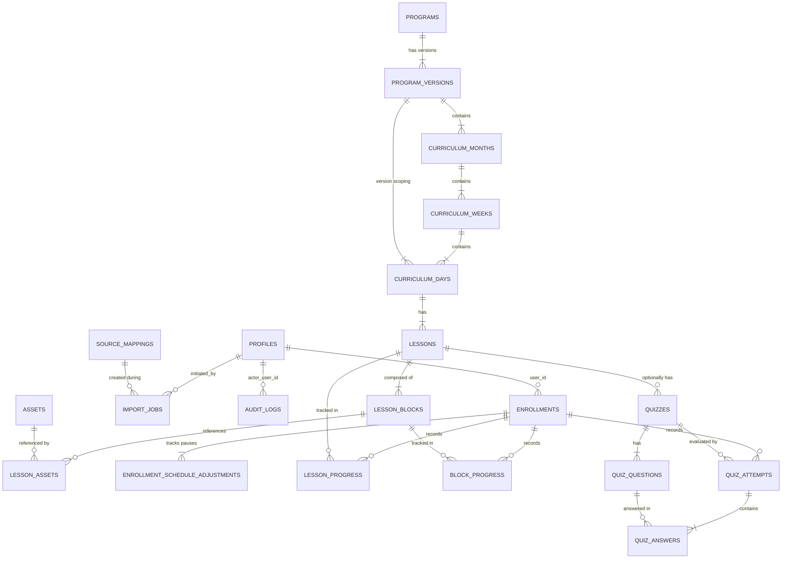

# Database Schema & Security Architecture

**Project:** Chinese Learning Journey (Hành trình chinh phục Tiếng Trung Toàn diện)  
**Database Engine:** Supabase PostgreSQL 15+  
**Migration File:** `supabase/migrations/20261110000000_init_schema.sql`  
**Seed Fixture:** `supabase/seed.sql`  
**TypeScript Types:** `src/types/database.ts`  

---

## 1. Architectural Principles

1. **Strict User Isolation via Row-Level Security (RLS):**
   - Students can only view and mutate their own profile, enrollments, daily lesson progress, and quiz attempts.
   - Students cannot read future locked lessons or other students' progress.
2. **Deterministic Timezone-Aware Unlocking:**
   - Unlocking is calculated using local dates in `Asia/Ho_Chi_Minh` (`YYYY-MM-DD`).
   - Millisecond-to-day conversion (`86,400,000`) is strictly forbidden to prevent DST/UTC leap anomalies.
3. **Quiz Answer Protection & Server-Side Grading:**
   - Correct answers and answer keys are never exposed to the client prior to quiz submission.
   - Access to `quiz_questions.correct_answer_jsonb` is revoked for `anon` and `authenticated` roles.
   - Grading is performed atomically server-side via the `submit_quiz_attempt` SQL stored procedure or Next.js server actions.
4. **Role Escalation Defense:**
   - The trigger `trg_check_profile_role_update` prevents non-admin users from escalating their role from `student` to `admin`.
   - The user creation trigger `handle_new_user` guarantees that new signups always receive the `student` role regardless of untrusted metadata sent by the client.

---

## 2. Entity-Relationship Diagram (ERD)



---

## 3. Detailed Table Specifications

### 3.1 `profiles`
User accounts extending Supabase `auth.users`.
- `id` (UUID, PK, FK `auth.users.id` ON DELETE CASCADE)
- `display_name` (TEXT, NOT NULL)
- `age_group` (TEXT, NOT NULL DEFAULT 'adult', CHECK `in ('adult', 'teen', 'kid', 'all', ...)`)
- `timezone` (TEXT, NOT NULL DEFAULT 'Asia/Ho_Chi_Minh')
- `role` (TEXT, NOT NULL DEFAULT 'student', CHECK `in ('student', 'admin', 'guardian')`)
- `created_at` (TIMESTAMPTZ, NOT NULL DEFAULT now())
- `updated_at` (TIMESTAMPTZ, NOT NULL DEFAULT now())

### 3.2 `programs` & `program_versions`
Curriculum definitions supporting immutable versioning.
- **`programs`**:
  - `id` (UUID, PK)
  - `slug` (TEXT, UNIQUE, NOT NULL)
  - `title` (TEXT, NOT NULL)
  - `description` (TEXT)
  - `target_age_group` (TEXT, NOT NULL DEFAULT 'all')
  - `status` (TEXT, NOT NULL DEFAULT 'draft', CHECK `in ('draft', 'published', 'archived')`)
  - `created_at`, `updated_at` (TIMESTAMPTZ)
- **`program_versions`**:
  - `id` (UUID, PK)
  - `program_id` (UUID, FK `programs.id` ON DELETE CASCADE)
  - `version_number` (TEXT / INT, NOT NULL)
  - `status` (TEXT, NOT NULL DEFAULT 'draft', CHECK `in ('draft', 'published', 'archived', 'active')`)
  - `published_at` (TIMESTAMPTZ)
  - `source_url` (TEXT)
  - `content_checksum` (TEXT)
  - `changelog` (TEXT)
  - `created_at`, `updated_at` (TIMESTAMPTZ)
  - *Constraint:* `UNIQUE (program_id, version_number)`

### 3.3 Curriculum Hierarchy: Months, Weeks, Days
- **`curriculum_months`**:
  - `id` (UUID, PK)
  - `program_version_id` (UUID, FK `program_versions.id` ON DELETE CASCADE)
  - `month_index` (INT, CHECK `1 <= month_index <= 12`)
  - `title` (TEXT, NOT NULL)
  - `sort_order` (INT, NOT NULL DEFAULT 1)
  - *Constraint:* `UNIQUE (program_version_id, month_index)`
- **`curriculum_weeks`**:
  - `id` (UUID, PK)
  - `curriculum_month_id` (UUID, FK `curriculum_months.id` ON DELETE CASCADE)
  - `week_index` (INT, CHECK `1 <= week_index <= 52`)
  - `title` (TEXT, NOT NULL)
  - `sort_order` (INT, NOT NULL DEFAULT 1)
  - *Constraint:* `UNIQUE (curriculum_month_id, week_index)`
- **`curriculum_days`**:
  - `id` (UUID, PK)
  - `curriculum_week_id` (UUID, FK `curriculum_weeks.id` ON DELETE CASCADE)
  - `program_version_id` (UUID, FK `program_versions.id` ON DELETE CASCADE)
  - `day_index` (INT, CHECK `1 <= day_index <= 366`)
  - `day_type` (TEXT, CHECK `in ('learning', 'review', 'quiz', 'rest', 'checkpoint')`)
  - `title` (TEXT, NOT NULL)
  - `estimated_minutes` (INT, NOT NULL DEFAULT 15)
  - `unlock_offset_days` (INT, NOT NULL DEFAULT 0, CHECK `>= 0`)
  - `is_required` (BOOLEAN, NOT NULL DEFAULT true)
  - `sort_order` (INT, NOT NULL DEFAULT 1)
  - *Constraint:* `UNIQUE (program_version_id, day_index)`

### 3.4 `lessons` & `lesson_blocks`
Atomic instructional units.
- **`lessons`**:
  - `id` (UUID, PK)
  - `curriculum_day_id` (UUID, FK `curriculum_days.id` ON DELETE CASCADE)
  - `title` (TEXT, NOT NULL)
  - `description` (TEXT)
  - `sort_order` (INT, NOT NULL DEFAULT 1)
  - `estimated_minutes` (INT, NOT NULL DEFAULT 15)
  - `is_required` (BOOLEAN, NOT NULL DEFAULT true)
- **`lesson_blocks`**:
  - `id` (UUID, PK)
  - `lesson_id` (UUID, FK `lessons.id` ON DELETE CASCADE)
  - `type` (TEXT, CHECK `in ('rich_text', 'video', 'audio', 'pdf', 'image', 'vocabulary', 'flashcard_set', 'instructions', 'quiz', 'external_resource')`)
  - `payload_jsonb` (JSONB, NOT NULL DEFAULT '{}')
  - `sort_order` (INT, NOT NULL DEFAULT 1)
  - `is_required` (BOOLEAN, NOT NULL DEFAULT true)
  - `estimated_minutes` (INT, NOT NULL DEFAULT 5)

### 3.5 `assets` & `lesson_assets`
Safe media files and external Google Drive references.
- **`assets`**:
  - `id` (UUID, PK)
  - `provider` (TEXT, NOT NULL DEFAULT 'google_drive')
  - `drive_file_id` (TEXT)
  - `name` (TEXT, NOT NULL)
  - `mime_type` (TEXT)
  - `web_view_link` (TEXT)
  - `resource_key` (TEXT)
  - `access_mode` (TEXT, CHECK `in ('direct', 'embed', 'fallback_link', 'anyone_with_link')`)
  - `status` (TEXT, CHECK `in ('valid', 'broken', 'restricted', 'pending_check', 'verified')`)
  - `last_checked_at` (TIMESTAMPTZ)
  - `source_url` (TEXT)
  - `metadata_jsonb` (JSONB, NOT NULL DEFAULT '{}')
- **`lesson_assets`**:
  - `id` (UUID, PK)
  - `lesson_block_id` (UUID, FK `lesson_blocks.id` ON DELETE CASCADE)
  - `asset_id` (UUID, FK `assets.id` ON DELETE CASCADE)
  - `sort_order` (INT, NOT NULL DEFAULT 1)
  - *Constraint:* `UNIQUE (lesson_block_id, asset_id)`

### 3.6 `enrollments` & `enrollment_schedule_adjustments`
Student enrollment instances and dynamic schedule pausing.
- **`enrollments`**:
  - `id` (UUID, PK)
  - `user_id` (UUID, FK `auth.users.id` ON DELETE CASCADE)
  - `program_version_id` (UUID, FK `program_versions.id` ON DELETE CASCADE)
  - `start_date` (DATE, NOT NULL)
  - `timezone` (TEXT, NOT NULL DEFAULT 'Asia/Ho_Chi_Minh')
  - `status` (TEXT, NOT NULL DEFAULT 'active', CHECK `in ('active', 'paused', 'completed', 'cancelled')`)
  - `paused_at` (TIMESTAMPTZ)
  - `pause_total_days` (INT, NOT NULL DEFAULT 0)
  - `target_minutes_per_day` (INT, NOT NULL DEFAULT 15)
  - *Index:* Partial unique index on `(user_id, program_version_id) WHERE status = 'active'`
- **`enrollment_schedule_adjustments`**:
  - `id` (UUID, PK)
  - `enrollment_id` (UUID, FK `enrollments.id` ON DELETE CASCADE)
  - `reason` (TEXT, NOT NULL)
  - `days_adjusted` (INT, NOT NULL)
  - `created_at` (TIMESTAMPTZ)

### 3.7 Progress: `lesson_progress` & `block_progress`
- **`lesson_progress`**:
  - `id` (UUID, PK)
  - `enrollment_id` (UUID, FK `enrollments.id` ON DELETE CASCADE)
  - `lesson_id` (UUID, FK `lessons.id` ON DELETE CASCADE)
  - `status` (TEXT, NOT NULL DEFAULT 'not_started', CHECK `in ('not_started', 'in_progress', 'completed')`)
  - `completed_required_blocks` (INT or BOOLEAN)
  - `started_at`, `completed_at` (TIMESTAMPTZ)
  - `score` (NUMERIC)
  - *Constraint:* `UNIQUE (enrollment_id, lesson_id)`
- **`block_progress`**:
  - `id` (UUID, PK)
  - `enrollment_id` (UUID, FK `enrollments.id` ON DELETE CASCADE)
  - `lesson_block_id` (UUID, FK `lesson_blocks.id` ON DELETE CASCADE)
  - `completed_at` (TIMESTAMPTZ NOT NULL DEFAULT now())
  - `metadata_jsonb` (JSONB)
  - *Constraint:* `UNIQUE (enrollment_id, lesson_block_id)`

### 3.8 Quizzes, Questions, Attempts & Answers
- **`quizzes`**:
  - `id` (UUID, PK)
  - `lesson_id` (UUID, FK `lessons.id` ON DELETE CASCADE)
  - `title` (TEXT, NOT NULL)
  - `passing_score` (INT, NOT NULL DEFAULT 80)
  - `attempt_limit` (INT, NULL for unlimited)
  - `status` (TEXT, CHECK `in ('draft', 'published', 'archived', 'active')`)
- **`quiz_questions`**:
  - `id` (UUID, PK)
  - `quiz_id` (UUID, FK `quizzes.id` ON DELETE CASCADE)
  - `type` (TEXT, CHECK `in ('single_choice', 'multiple_choice', 'true_false', 'fill_blank')`)
  - `prompt_jsonb` (JSONB, NOT NULL DEFAULT '{}')
  - `correct_answer_jsonb` (JSONB, NOT NULL DEFAULT '{}') — *Hidden from student queries!*
  - `explanation_jsonb` (JSONB)
  - `points` (INT, NOT NULL DEFAULT 10)
  - `sort_order` (INT, NOT NULL DEFAULT 1)
- **`quiz_attempts`**:
  - `id` (UUID, PK)
  - `enrollment_id` (UUID, FK `enrollments.id` ON DELETE CASCADE)
  - `quiz_id` (UUID, FK `quizzes.id` ON DELETE CASCADE)
  - `attempt_no` (INT, NOT NULL CHECK `>= 1`)
  - `submitted_at` (TIMESTAMPTZ NOT NULL DEFAULT now())
  - `score` (NUMERIC NOT NULL)
  - `passed` (BOOLEAN NOT NULL DEFAULT false)
  - *Constraint:* `UNIQUE (enrollment_id, quiz_id, attempt_no)`
- **`quiz_answers`**:
  - `id` (UUID, PK)
  - `attempt_id` (UUID, FK `quiz_attempts.id` ON DELETE CASCADE)
  - `question_id` (UUID, FK `quiz_questions.id` ON DELETE CASCADE)
  - `answer_jsonb` (JSONB)
  - `is_correct` (BOOLEAN NOT NULL DEFAULT false)
  - `awarded_points` (NUMERIC NOT NULL DEFAULT 0)
  - *Constraint:* `UNIQUE (attempt_id, question_id)`

### 3.9 Ingestion & System Auditing
- **`import_jobs`**:
  - `id` (UUID, PK)
  - `initiated_by` (UUID, FK `auth.users.id` ON DELETE SET NULL)
  - `source_kind` (TEXT, CHECK `in ('notion_api', 'notion_export', 'google_drive', 'manual_seed')`)
  - `status` (TEXT, CHECK `in ('pending', 'running', 'completed', 'failed', 'cancelled')`)
  - `summary_jsonb` (JSONB), `error_jsonb` (JSONB)
- **`source_mappings`**:
  - `id` (UUID, PK)
  - `source_type` (TEXT), `source_id` (TEXT), `target_type` (TEXT), `target_id` (UUID)
  - `source_hash` (TEXT)
  - *Constraint:* `UNIQUE (source_type, source_id, target_type)`
- **`audit_logs`**:
  - `id` (UUID, PK)
  - `actor_user_id` (UUID, FK `auth.users.id` ON DELETE SET NULL)
  - `action` (TEXT), `entity_type` (TEXT), `entity_id` (TEXT)
  - `summary_jsonb` (JSONB)
  - `created_at` (TIMESTAMPTZ)

---

## 4. Row-Level Security (RLS) Policy Summary

| Table | SELECT | INSERT | UPDATE | DELETE |
| :--- | :--- | :--- | :--- | :--- |
| `profiles` | Own record or Admin | Own record or Admin | Own record or Admin (role locked) | Admin only |
| `programs` | Published or Admin | Admin only | Admin only | Admin only |
| `program_versions` | Published or Admin | Admin only | Admin only | Admin only |
| `curriculum_months` | Published or Admin | Admin only | Admin only | Admin only |
| `curriculum_weeks` | Published or Admin | Admin only | Admin only | Admin only |
| `curriculum_days` | Published or Admin | Admin only | Admin only | Admin only |
| `lessons` | Published or Admin | Admin only | Admin only | Admin only |
| `lesson_blocks` | Unlocked days only (or Admin) | Admin only | Admin only | Admin only |
| `assets` | Unlocked days only (or Admin) | Admin only | Admin only | Admin only |
| `lesson_assets` | Unlocked days only (or Admin) | Admin only | Admin only | Admin only |
| `enrollments` | Own enrollment or Admin | Own enrollment or Admin | Own enrollment or Admin | Admin only |
| `enrollment_adjustments` | Own enrollment or Admin | Own enrollment or Admin | Admin only | Admin only |
| `lesson_progress` | Own enrollment or Admin | Own enrollment or Admin | Own enrollment or Admin | Admin only |
| `block_progress` | Own enrollment or Admin | Own enrollment or Admin | Own enrollment or Admin | Admin only |
| `quizzes` | Unlocked days only (or Admin) | Admin only | Admin only | Admin only |
| `quiz_questions` | Unlocked days only (safe cols only) | Admin only | Admin only | Admin only |
| `quiz_attempts` | Own attempts or Admin | Own attempts or Admin | Admin only | Admin only |
| `quiz_answers` | Own answers or Admin | Own answers or Admin | Admin only | Admin only |
| `import_jobs` | Admin only | Admin only | Admin only | Admin only |
| `source_mappings` | Admin only | Admin only | Admin only | Admin only |
| `audit_logs` | Admin only | Authenticated | Admin only | Admin only |

---

## 5. Daily Unlocking Logic Specification

A day is unlocked for a student if:
```sql
(timezone(COALESCE(e.timezone, 'Asia/Ho_Chi_Minh'), now()))::date >= 
(e.start_date + (cd.unlock_offset_days + COALESCE(e.pause_total_days, 0)))
```

Key guarantees:
1. Two students with different `start_date` values will unlock different lessons on the same calendar day.
2. If a student misses days, overdue lessons remain accessible; lessons are never auto-skipped.
3. Days in the future remain locked until their local unlock date arrives.
4. Pauses shift all subsequent unlock dates deterministically without modifying past completed progress records.

---

## 6. How to Run Migrations & Seeds

### Local Supabase (via CLI)
```bash
# Start local Supabase instance
supabase start

# Apply all migrations
supabase db reset

# Seed demo data
supabase db seed
```

### In-Memory Mock Mode (No Local Supabase Required)
When working offline or running Vitest unit tests:
```bash
# In .env.local:
USE_MOCK_SUPABASE=true
```
The application will automatically use `src/lib/supabase/mock-adapter.ts`, pre-loaded with the realistic Month 1 `[DEMO]` curriculum.
