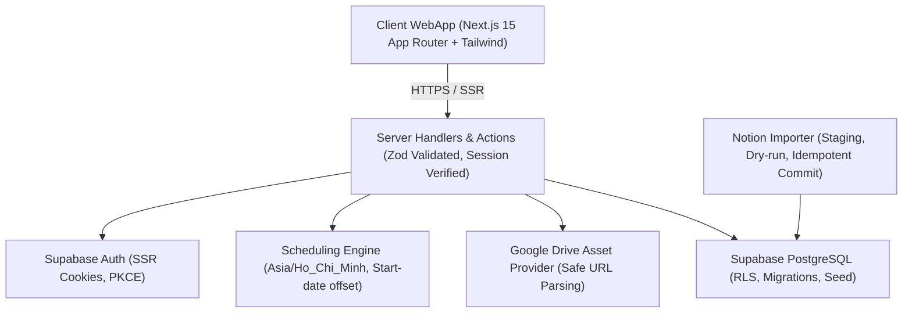

# Chinese Learning Journey — Implementation Plan & Architecture

## 1. Executive Summary & Goals
The objective of this project is to build an MVP production-grade self-study Chinese Learning Management System (LMS) based on the comprehensive 12-month Chinese learning roadmap (Notion source: `https://judicious-crafter-764.notion.site/L-TR-NH-H-C-TI-NG-TRUNG-CHO-NG-I-M-I-B-T-U-129db0ebd82b4b5cb9c13a343a937567`).

Key requirements:
1. **Dynamic Daily Progression & Calendar Unlock**: Every student has their own `start_date` and `timezone` (`Asia/Ho_Chi_Minh` default). Content is unlocked daily relative to start date.
2. **Backlog & Makeup Learning**: Missed days do not auto-skip or disappear; students can catch up at their own pace without unlocking future days prematurely.
3. **Multi-type Lesson Blocks**: Rich text, Google Drive MP3/MP4/PDF, vocabulary (Hanzi, Pinyin, Vietnamese meaning, examples), flashcards, practice, and interactive quizzes.
4. **Google Drive Integration**: Safe URL parsing, embedded previews, fallback links, access validation without crashing.
5. **Robust Supabase Backend**: PostgreSQL schemas, strict Row-Level Security (RLS), server-side quiz grading (no client-side answer key leaks), and audit trails.
6. **Admin CMS & Notion Importer**: Staging preview, dry-run, conflict detection, and idempotent commit for Notion exports.

---

## 2. System Architecture

---

## 3. Milestones & Phases

### Phase A: Foundation
- Scaffold Next.js 15, TypeScript, Tailwind CSS, Lucide icons, Vitest.
- Supabase SSR client (`@supabase/ssr`) with cookie handling and development mock adapter.
- PostgreSQL migrations with RLS policies, indexes, and seed demo fixtures.
- Auth pages (`/login`, `/register`, `/forgot-password`) and Onboarding (`/onboarding`).

### Phase B: Core Daily Learning Engine
- Program, version, month, week, day, lesson, and lesson block data models.
- Pure TypeScript scheduling library (`lib/scheduling/`): local date calculation, unlock offset days, backlog computation, leap year tests.
- Student views: `/dashboard`, `/roadmap`, `/learn/[dayId]`, `/lesson/[lessonId]`, `/progress`.
- Progress tracking: block completion & lesson completion validation.

### Phase C: Google Drive & Quiz Engine
- Google Drive URL parser & asset provider abstraction (`lib/google-drive/`).
- Lesson block renderers: Audio player, Video preview, PDF viewer fallback, Vocabulary list, Flashcards, Quiz.
- Server-side quiz evaluation (`/api/quizzes/[id]/submit`) with scoring and attempt tracking.
- Practice UI (`/practice/[quizId]`).

### Phase D: Admin CMS & Notion Content Importer
- Admin dashboard (`/admin`), curriculum editor (`/admin/curriculum`), asset manager (`/admin/assets`), program version publisher (`/admin/programs`).
- Notion export parser (`lib/notion-import/`): parser for exported Markdown/CSV/JSON, staging validation, dry-run report, and idempotent commit.
- Verification dashboard: content completeness report & broken link diagnostics.

### Phase E: Hardening, Verification & Documentation
- Responsive polish for 390px mobile up to desktop.
- Unit, integration, and E2E verification test suites.
- Comprehensive documentation: `README.md`, `docs/ARCHITECTURE.md`, `docs/DB_SCHEMA.md`, `docs/DEPLOYMENT.md`, `docs/ADMIN_GUIDE.md`, `docs/CONTENT_IMPORT.md`, `docs/TEST_REPORT.md`.

---

## 4. Risks & Mitigations
| Risk | Impact | Mitigation |
|------|--------|------------|
| Timezone & DST errors in unlock schedule | Critical | Pure date calculation using local ISO date strings (`YYYY-MM-DD`) and `date-fns-tz` at `Asia/Ho_Chi_Minh`. Dedicated test suite covering 23:59 vs 00:01 boundaries. |
| Quiz answer leaking in client payload | High | Answer keys stored in protected tables / excluded from student endpoints; grading executed strictly in server transaction. |
| Malicious Google Drive URLs / SSRF | High | Strict domain validation (only `drive.google.com`, `docs.google.com`), regex file ID extraction, sanitized embed generation. |
| Notion content hallucination | High | Clear DEMO flag on seed fixtures; real content imported via validated importer with staging report. |
| Future lesson unauthorized access | High | Row-Level Security checks and API server validation verifying enrollment unlock offset before returning lesson content. |
